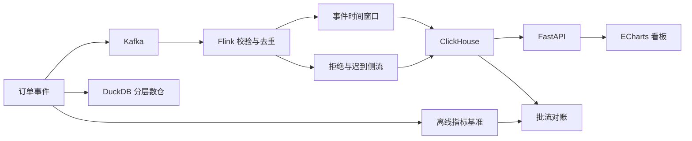

<div align="center">

# 电商实时数据仓库与经营分析平台

从订单事件采集、实时计算和分析存储，到经营看板、质量治理与批流对账的一体化数据平台。

[](https://github.com/ZliY221/Real-time-data-warehouse-and-business-analysis-platform-for-e-commerce/actions/workflows/ci.yml)
[](https://github.com/ZliY221/Real-time-data-warehouse-and-business-analysis-platform-for-e-commerce/actions/workflows/portable-smoke.yml)


[快速启动](#快速启动) · [系统架构](#系统架构) · [核心能力](#核心能力) · [项目文档](#项目文档) · [版本记录](CHANGELOG.md)

</div>

## 项目简介

平台围绕电商订单经营分析构建可运行的数据链路。订单事件进入 Kafka 后，由 Flink 按事件时间完成校验、去重、Watermark 推进和分钟窗口聚合，结果写入 ClickHouse，并通过 FastAPI 与 ECharts 提供经营指标和链路诊断。同时保留 DuckDB 离线数仓、数据质量历史和独立批流对账，便于核对指标口径。

| 关注点 | 项目实现 |
| --- | --- |
| 经营分析 | 分钟订单量、GMV、客单价、地区、渠道及商品品类表现 |
| 周期决策 | 当前区间与上一等长区间的订单、GMV、客单价增长对比 |
| 实时计算 | Kafka、Flink Event Time、Watermark、状态去重 |
| 数据存储 | ClickHouse 实时指标与异常审计、DuckDB 分层数仓 |
| 数据可信 | 契约校验、质量门禁、批流逐键对账、新鲜度 SLO |
| 服务展示 | FastAPI 查询接口、ECharts 经营与资产健康看板 |

## 快速启动

仅运行不依赖外部服务的可移植数据流：

```powershell
python scripts/bootstrap.py
```

完成后可在 `build/quickstart/` 查看运行摘要、DuckDB 数据库和聚合报告。

启动固定数据的经营看板预览：

```powershell
./scripts/dashboard-preview.ps1
```

访问 `http://127.0.0.1:8000/dashboard`。完整实时链路的安装和启动步骤见[用户使用指南](docs/user-guide.md)。

## 系统架构



## 核心能力

### 实时数仓

- 使用事件时间和 Watermark 处理乱序订单，按 `event_id` 保持去重语义。
- 使用 ClickHouse `ReplacingMergeTree` 管理重放产生的多版本结果。
- 保存异常类型和必要指纹，不持久化原始异常载荷。

### 数据治理

- 通过 JSON Schema 和配置化规则检查完整性、唯一性、范围、及时性与分布漂移。
- 使用 SQLite 保存质量运行历史，并在看板展示规则趋势。
- 建立 Topic、流、表、API 和看板的资产目录、新鲜度 SLO 与下游影响关系。

### 离线分析与核对

- 使用 DuckDB 构建 ODS、DIM、DWD、DWS、ADS 分层模型。
- 按相同业务口径独立重算分钟指标，与实时结果逐键核对。
- 使用稳定输入指纹实现重复装载保护和运行追溯。

### 运营看板

- 展示 GMV、订单量、客单价、趋势、地区和渠道分布。
- 展示质量历史、拒绝与迟到事件摘要以及资产健康状态。
- 支持按健康状态和责任团队筛选资产，并定位受影响下游。
- 支持保存、应用和删除个人经营视图，保留时间窗口、维度筛选与刷新频率。
- 自动生成上一等长经营周期，联动地区和渠道筛选展示三项核心指标环比。
- 支持上一时段、昨日同期和上周同期三种对比基准，并随经营视图保存。
- 拆解地区或渠道的 GMV 变化贡献，快速定位增长来源与下降项。
- 点击贡献项即可下钻到对应地区或渠道，并联动刷新全局经营指标。
- 下钻项提供选中高亮、当前上下文说明和独立清除入口。
- 商品分析按品类或 SKU 汇总订单数、销量与 GMV，支持品类筛选和实时联动刷新。

## 工程结构

```text
dashboard/             ECharts 经营看板
flink-job/             Java / Flink 实时计算作业
infra/clickhouse/      ClickHouse 初始化结构
schemas/               订单事件契约
src/data_quality/      数据质量规则与历史
src/event_generator/   确定性事件生成
src/metrics_api/       FastAPI 查询服务
src/offline_warehouse/ DuckDB 分层数仓
src/reconciliation/    批流指标对账
tests/                 Python 自动化验证
```

## 常用入口

| 目标 | 命令或入口 |
| --- | --- |
| 环境检查 | `python scripts/project_doctor.py --profile full` |
| 本地数据流 | `python scripts/quickstart.py` |
| 统一工程验证 | `./scripts/test-all.ps1` |
| Kafka 本地环境 | `./scripts/kafka-up.ps1` |
| ClickHouse 本地环境 | `./scripts/clickhouse-up.ps1` |
| 查询服务 | `./scripts/api-up.ps1` |
| 看板预览 | `./scripts/dashboard-preview.ps1` |

## 项目文档

- [用户使用指南](docs/user-guide.md)
- [运行环境分层](docs/runtime-environments.md)
- [系统架构](docs/architecture.md)
- [事件数据字典](docs/data-dictionary.md)
- [Flink 事件时间与窗口](docs/flink-event-time.md)
- [ClickHouse 指标存储](docs/clickhouse-sink.md)
- [离线维度数仓](docs/offline-dimensional-warehouse.md)
- [批流指标一致性核对](docs/batch-stream-reconciliation.md)
- [数据质量诊断看板](docs/quality-diagnostics-dashboard.md)
- [数据资产血缘与新鲜度](docs/data-asset-freshness.md)

## 运行边界

- 仓库使用匿名合成数据，不包含真实订单或用户信息。
- 本地快速启动使用 DuckDB；完整实时链路需要 Docker、JDK 17 和 Maven。
- 性能结果仅适用于对应的运行环境与固定输入，不外推为生产容量。
- JDBC Sink 提供批量与重试语义，不声明端到端 exactly-once。

## 版本与维护

当前版本为 `v4.8.0`。实时经营指挥台新增价格一致性护栏，对目录价、审批折扣、实时折扣与结算价进行逐 SKU 核对，及时识别超折扣和结算差异。每次发布同步维护[用户使用指南](docs/user-guide.md)、[版本记录](CHANGELOG.md)和[版本摘要](VERSION_LOG.md)。
